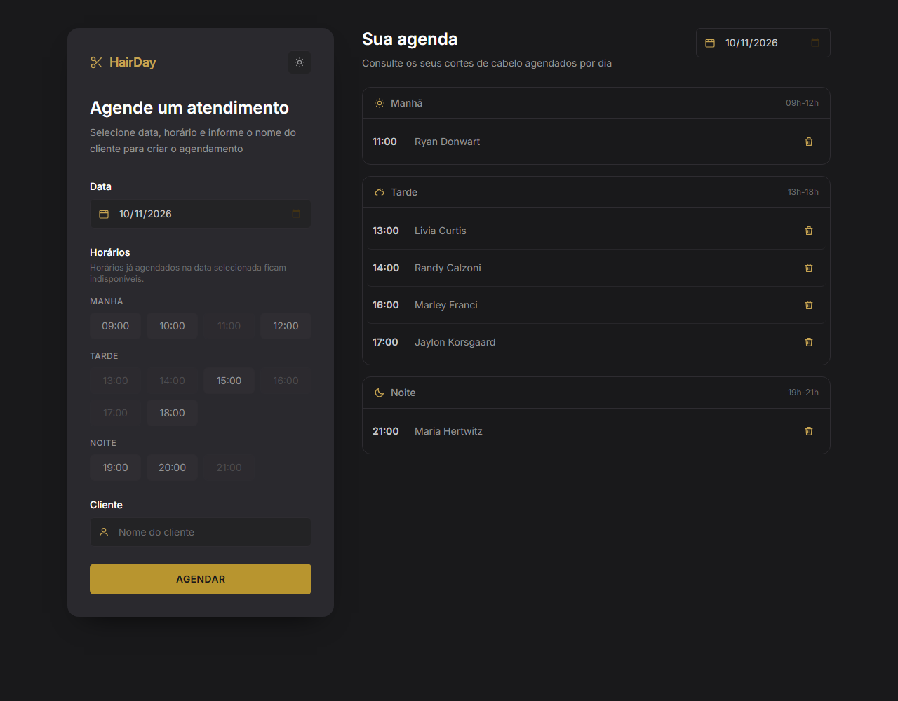
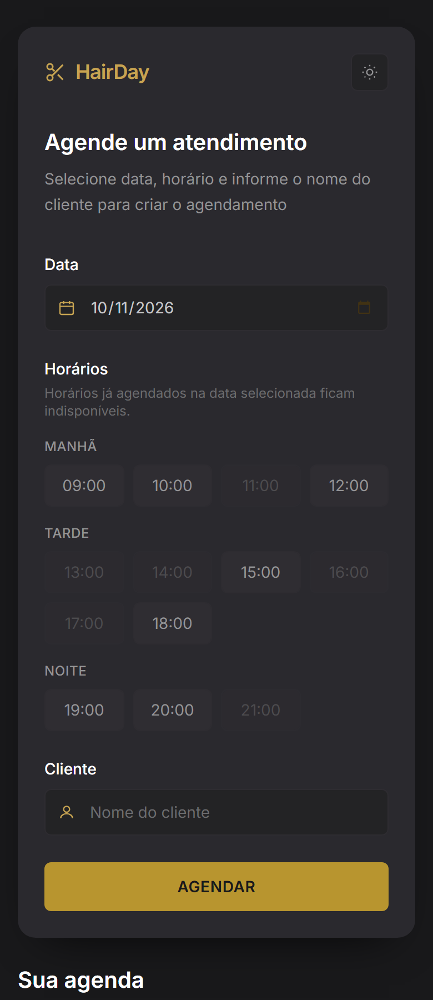
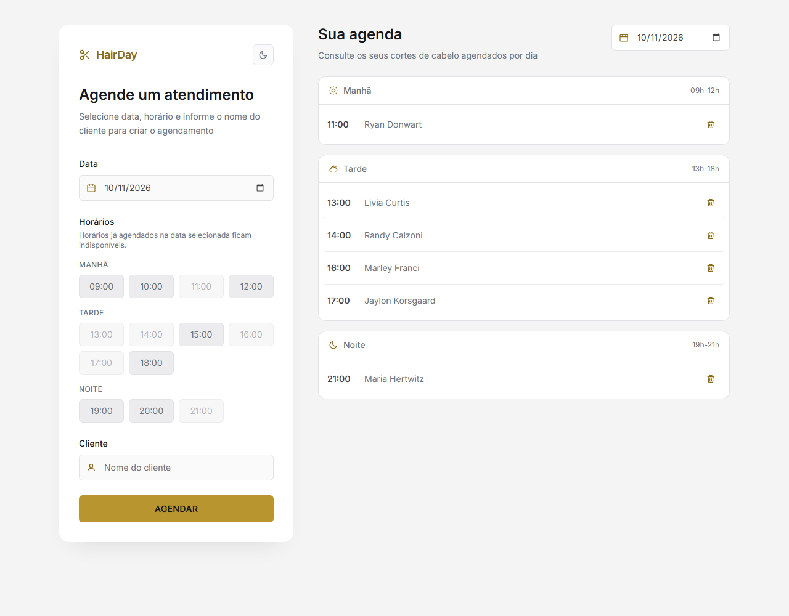

# 💇 HairDay

Aplicação web de agendamento de cortes de cabelo, construída com **React**, **TypeScript**, **Vite** e **Tailwind CSS**, seguindo o protótipo do Figma.



## 📦 Materiais de entrega

| Item | Onde está |
| --- | --- |
| Repositório GitHub com o código-fonte completo | <https://github.com/Devpaulo1/hairday> |
| README com descrição, tecnologias e instruções | este arquivo |
| AGENTS.md usado para orientar o agente de IA | [`AGENTS.md`](AGENTS.md) |
| Capturas desktop e mobile | [`docs/screenshots/`](docs/screenshots/) (nos dois temas) |
| Evidências do Context7 MCP | [`docs/context7-evidence.md`](docs/context7-evidence.md) |
| Evidências de testes (Playwright) | [`docs/playwright-report/index.html`](docs/playwright-report/index.html) · [`docs/resultados-playwright.txt`](docs/resultados-playwright.txt) |

## ✨ Funcionalidades

- **Formulário de agendamento**: data, horário (13 horários fixos do protótipo) e nome do cliente.
- **Validação**: o cadastro só acontece com data, horário e nome preenchidos; o nome é limpo com `trim()`.
- **Horários ocupados**: os horários já agendados na data selecionada ficam esmaçados e não clicáveis (como no Figma).
- **Agenda por dia**: os agendamentos são filtrados pela data selecionada no cabeçalho.
- **Três períodos**: Manhã (09h-12h), Tarde (13h-18h) e Noite (19h-21h), com ordenação crescente por horário.
- **Exclusão individual**: botão de lixeira com nome acessível (`aria-label="Excluir agendamento de [nome]"`).
- **Estado vazio**: cada período sem registros mostra a mensagem *"Você ainda não tem agendamentos cadastrados nesse período."*
- **Responsivo**: no desktop o formulário fica à esquerda e a agenda à direita; em telas menores os blocos viram uma coluna.
- **Tema claro e escuro**: o botão no canto do painel alterna entre os dois temas. A preferência fica salva no `localStorage` e é aplicada antes da primeira pintura (sem "flash" ao recarregar).



### Tema claro



> O tema **escuro** é o padrão (é o que o Figma define). O tema **claro** é ativado pelo botão de sol/lua no topo do painel lateral.

## 🚀 Como executar

```bash
npm install
npm run dev      # servidor de desenvolvimento
npm run build    # build de produção (tsc -b && vite build)
npm run lint     # oxlint
npm run preview  # pré-visualiza o build
npm test         # testes end-to-end com Playwright
```

> **Atenção:** os dados ficam apenas em memória. Ao recarregar a página, a agenda volta a ser vazia.

## 🧠 Conceitos de React e TypeScript usados

| Conceito | Onde aparece | Para que serve |
| --- | --- | --- |
| `useState` | `AppointmentForm`, `App` | Guarda os campos do formulário e a data exibida na agenda |
| `createContext` / `useContext` | `context/ScheduleContext.ts`, `context/ScheduleProvider.tsx` | Compartilhar a lista de agendamentos entre componentes sem "prop drilling" |
| Custom hook | `hooks/useAppointments.ts` | Atalho tipado para consumir o contexto, com erro claro fora do Provider |
| Props tipadas | todos os componentes | Cada componente declara o que recebe (`type`) |
| `map()` | listas de horários e de agendamentos | Renderiza coleções |
| `filter()` | `AppointmentList` | Separa os registros da data selecionada |
| Função auxiliar tipada (equivalente a `reduce`) | `groupByPeriod` | Agrupa os agendamentos em Manhã, Tarde e Noite |
| Imutabilidade | `ScheduleProvider` | `setAppointments` sempre cria uma nova lista |

### Onde os dados moram

```
main.tsx
└── ScheduleProvider      ← guarda os agendamentos (useState)
    └── App
        ├── ScheduleSidebar
        │   └── AppointmentForm    ← usa useAppointments() para criar
        └── DateSelector + AppointmentList
            └── PeriodSection
                └── AppointmentItem  ← usa useAppointments() para excluir
```

O formulário **não** guarda a lista de agendamentos: ele apenas envia o novo registro ao contexto. A exclusão acontece direto no item da lista, pelo `id`.

## 🗂️ Estrutura de pastas

```text
src/
  components/
    AppointmentForm/     Formulário de criação
    AppointmentItem/     Linha da agenda (horário, cliente, lixeira)
    AppointmentList/     Lista do dia, agrupada por período
    DateSelector/        Seletor de data da agenda
    PeriodSection/       Seção Manhã / Tarde / Noite
    ScheduleSidebar/     Painel lateral (logo, título, formulário)
    ThemeToggle/         Botão que alterna o tema claro/escuro
    Icons.tsx            Ícones SVG inline (sem biblioteca externa)
  context/
    ScheduleContext.ts   Criação do contexto e do tipo do valor
    ScheduleProvider.tsx Componente que guarda o estado
  hooks/
    useAppointments.ts   Hook para consumir o contexto
    useTheme.ts          Hook do tema (classe `dark` + localStorage)
  types/
    appointment.ts       Tipo Appointment e PeriodId
  utils/
    appointmentHelpers.ts Períodos, horários, agrupamento, datas e id
  App.tsx
  main.tsx
  index.css              Tokens de design (@theme) e estilos base

tests/
  hairday.spec.ts        Testes end-to-end (Playwright)

docs/
  context7-evidence.md   Evidências das consultas ao Context7 MCP
  playwright-report/     Relatório HTML da última execução dos testes
  resultados-playwright.txt Saída da última execução dos testes
  screenshots/           Capturas desktop e mobile nos dois temas

playwright.config.ts     Configuração do Playwright
```

## 🎨 Tokens de design

As cores foram extraídas do frame "Projeto" do Figma e transformadas em variáveis do Tailwind v4.
Cada tema define as **variáveis de runtime** (`--app-*`) e o bloco `@theme inline` as espelha para
os utilitários do Tailwind — assim, trocar de tema não exige re-renderizar nada em React.

| Token | Escuro (Figma) | Claro | Uso |
| --- | --- | --- | --- |
| `surface` | `#19191b` | `#f4f4f5` | Fundo da aplicação |
| `surface-raised` | `#2a292e` | `#ffffff` | Painel lateral |
| `surface-inset` | `#232325` | `#fafafa` | Campos de data e cliente |
| `surface-hover` | `#2f2d32` | `#ececee` | Botões de horário e hover das linhas |
| `card` | `#19191b` | `#ffffff` | Cards dos períodos e seletor de data da agenda |
| `line` | `#2e2c31` | `#e2e2e6` | Bordas |
| `accent` | `#b8952f` | `#a9821d` | Botão Agendar |
| `accent-soft` | `#c7a452` | `#8a6a12` | Logo, ícones e horário selecionado |
| `on-accent` | `#19191b` | `#1c1917` | Texto do botão Agendar |
| `content-strong` | `#ffffff` | `#18181b` | Títulos |
| `content` | `#c7c7c9` | `#3f3f46` | Horário do agendamento |
| `content-muted` | `#939395` | `#6b7280` | Nome do cliente e textos de apoio |
| `content-subtle` | `#6c6c6e` | `#71717a` | Faixas de horário e estados vazios |
| `danger` | `#f87171` | `#dc2626` | Mensagens de erro |

> Todos os valores do tema escuro foram **amostrados pixel a pixel** no frame do Figma e conferidos
> contra os estilos computados da aplicação. O tema claro mantém a mesma linguagem visual, com
> contraste ajustado para texto claro sobre fundo claro.

## 🔗 Protótipo

[Figma — Plataforma de agendamento (frame "Projeto", node 3-376)](https://www.figma.com/design/hirNhBBECqlfEjOfZk2Bpr/Plataforma-de-agendamento--Community---Copy---c%C3%B3pia-?node-id=3-376)

### Fidelidade com o protótipo

| Elemento | Figma | Implementação | Status |
| --- | --- | --- | --- |
| Cores de fundo, campos, chips e botão | `#19191b`, `#232325`, `#2f2d32`, `#b8952f` | idênticos (verificado nos estilos computados) | ✅ |
| Ícones (calendário, usuário, lixeira, períodos) | dourados | `#c7a452` | ✅ |
| Logo HairDay com tesoura | dourado | idêntico | ✅ |
| Botão AGENDAR (dourado, texto escuro) | `#b8952f` | idêntico | ✅ |
| Horários do protótipo (4 + 6 + 3) | 09:00-12:00, 13:00-18:00, 19:00-21:00 | idênticos | ✅ |
| Faixas dos períodos (`09h-12h`, `13h-18h`, `19h-21h`) | idênticas | idênticas | ✅ |
| Horário selecionado com borda dourada | dourado | idêntico | ✅ |
| Layout duas colunas no desktop | 380px + agenda | `380px 668px` | ✅ |
| Card do período com ícone, título e faixa | idêntico | idêntico | ✅ |
| Linha da agenda: horário, cliente, lixeira | idêntico | idêntico | ✅ |
| Formulário à esquerda, agenda à direita | sim | sim | ✅ |
| Empilhamento em telas pequenas | — | uma coluna | ✅ (adaptação) |
| Chips de horário já ocupados (esmaecidos) | sim | sim (`disabled` + `title`) | ✅ |
| Tema claro e escuro com alternância | — | botão sol/lua + `localStorage` | ✅ (feature extra) |
| Tipografia geométrica do protótipo | fonte do Figma | `Inter` (Google Fonts) | ✅ aproximação |
| Seta (chevron) no seletor de data | chevron | ícone nativo do navegador | ⚠️ aproximação acessível |

## 🧪 Testes executados

Testes **end-to-end automatizados com Playwright** (`tests/hairday.spec.ts`), executados em dois
projetos: **desktop** (1280×1000) e **mobile** (Pixel 7).

```bash
npm test                  # roda tudo (sobe o dev server na porta 4174 automaticamente)
npm run test:ui           # abre o modo interativo do Playwright
npm run test:report       # abre o relatório HTML gerado
```

**Resultado da última execução: 24 testes passando (12 verificações × 2 viewports), 0 falhas.**

| # | Verificação | Resultado |
| --- | --- | --- |
| 1 | A aplicação abre sem erros no console | ✅ |
| 2 | O formulário impede cadastro com campos ausentes | ✅ |
| 2b | Nome preenchido só com espaços é recusado (`trim()`) | ✅ |
| 3 | Um cadastro válido aparece na agenda sem recarregar a página | ✅ |
| 4 | O agendamento aparece na data correta (a agenda troca para a data criada) | ✅ |
| 5 | Alterar a data da agenda mostra só os registros daquele dia | ✅ |
| 6 | Registros no período correto e em ordem crescente de horário | ✅ |
| 7 | Cada período vazio mostra a mensagem exigida | ✅ |
| 8 | Excluir remove somente o agendamento selecionado | ✅ |
| 9 | Horário já agendado fica indisponível no formulário | ✅ |
| 10 | Layout de duas colunas no desktop e uma coluna no mobile (sem rolagem horizontal) | ✅ |
| 11 | O botão de tema alterna entre claro e escuro e guarda a preferência | ✅ |

**Relatório completo:** [`docs/playwright-report/index.html`](docs/playwright-report/index.html) · [`docs/resultados-playwright.txt`](docs/resultados-playwright.txt)

> O reporter HTML do Playwright recria a pasta `docs/playwright-report/` a cada execução,
> por isso o arquivo de resultados fica em `docs/resultados-playwright.txt` (fora dessa pasta).

### Limitações e observações

- O **Playwright MCP não está disponível** neste ambiente de desenvolvimento (o único recurso de
  navegador exposto era o Chromium integrado). Para entregar as evidências exigidas, foi
  instalado o **Playwright de verdade** (`@playwright/test`) com a suíte de testes acima — assim o
  projeto continua verificável por qualquer pessoa, com um único comando.
- Os testes usam o **Chrome já instalado** (`channel: 'chrome'`), o que dispensa baixar
  navegadores — importante porque o Smart App Control do Windows bloqueia binários recém-baixados.
- Não existe suíte de **testes unitários** (a lógica está coberta pelo teste end-to-end) nem
  auditoria automática de acessibilidade; a acessibilidade foi verificada manualmente:
  rótulos associados, `aria-label` na exclusão, `aria-pressed` nos horários, `role="alert"` no erro,
  foco visível e navegação por teclado.
- A captura de desktop foi gerada dentro de um `iframe` de 1400px (a janela do navegador do
  ambiente de automação tem 912px de largura), por isso as fontes aparecem um pouco menores que o natural.

## 📚 Consultas ao Context7

| Biblioteca | Temas consultados |
| --- | --- |
| `reactjs/react.dev` | `createContext` + Provider + `useContext`; `useState` e inputs controlados; tipagem de contexto em TypeScript |
| `tailwindlabs/tailwindcss.com` | diretiva `@theme` para criar cores customizadas no Tailwind v4 |

**Evidência completa (consultas, trechos oficiais e como viraram código):**
[`docs/context7-evidence.md`](docs/context7-evidence.md)

## 📌 Observações do ambiente

- A **Inter** é carregada do Google Fonts (`index.html`), então a fonte geométrica do protótipo só aparece com internet. Sem conexão, a aplicação cai automaticamente para `system-ui`.
- O **Smart App Control** do Windows bloqueia o binário nativo `lightningcss@1.33.0`. Por isso o projeto usa `tailwindcss@4.3.3` com o *override* `lightningcss@1.32.0` (versão liberada). Para voltar à 4.3.5, é preciso que o binário 1.33.0 seja liberado pelo sistema.
- Alterações no `vite.config.ts` exigem **reiniciar** o servidor de desenvolvimento para que o plugin do Tailwind seja aplicado.
- As capturas de `docs/screenshots/` foram geradas com Chrome headless via DevTools Protocol, criando agendamentos reais na aplicação (6 horários do protótipo).
